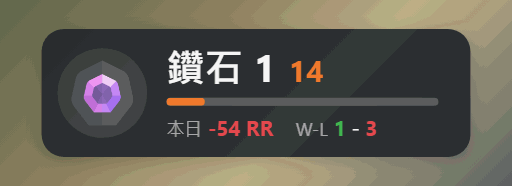
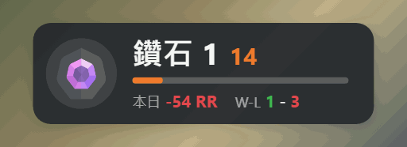
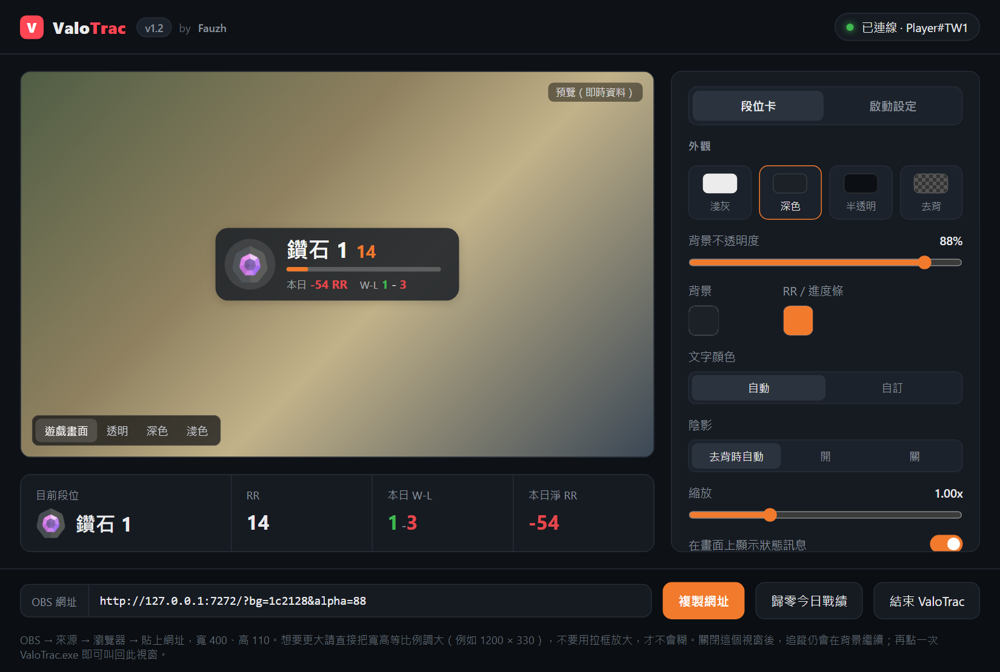

  

<h1 align="center">ValoTrac</h1>

  A free Windows companion app that tracks your VALORANT rank and RR, with an animated rank card for your stream or screen. 
  免費的 VALORANT 段位追蹤工具：打完一場，段位卡自己會動。

  <a href="../../releases/latest"><b>⬇ Download for Windows / 下載</b></a> ·
  <a href="https://fauzh.github.io/ValoTrac/">Website / 網站</a> ·
  <a href="https://fauzh.github.io/ValoTrac/privacy.html">Privacy / 隱私權</a>

  

---

## Features / 功能

| | English | 中文 |
|---|---|---|
| 🎴 | **Rank card**: current tier, RR, today's wins / losses and net RR. Add it to OBS or show it on screen. | **段位卡**：即時顯示段位、RR、本日勝敗與淨 RR，可放進 OBS 或直接顯示在螢幕上。 |
| ✨ | **Animations**: win, loss, rank-up and rank-down animations about 30 seconds after each match. | **上分動畫**：上分、掉分、升段、降段都有專屬動畫，比賽結束約 30 秒內自動更新。 |
| ⌨️ | **Hold Tab to show**: always visible, or only while holding Tab. Clicks pass straight through. | **按 Tab 顯示**：一直顯示或按住 Tab 才出現，滑鼠直接穿透。 |
| 📊 | **Match ranks** (optional, off by default): agents, ranks and season win rate or RR of both teams. No player names. | **查看段位**（選用，預設關閉）：選角與對戰中顯示雙方英雄、段位、勝率或 RR，不顯示玩家名字。 |
| 🌐 | **English / 中文** interface. | **中英文介面**。 |
| 🔒 | Never asks for your Riot password. Settings and stats stay on your PC. | 不需要帳號密碼，設定與戰績只存在你的電腦。 |

  

  

## Install / 安裝

1. Download **`ValoTrac-Setup.exe`** from [Releases](../../releases/latest).
   到 [Releases](../../releases/latest) 下載 **`ValoTrac-Setup.exe`**。
2. Run it. If Windows shows “Windows protected your PC”, click **More info → Run anyway** (the app isn't code-signed yet).
   執行安裝檔。如果出現「Windows 已保護您的電腦」，點 **其他資訊 → 仍要執行**（程式還沒有付費數位簽章）。
3. Click **Install**. No admin rights needed.
   按 **安裝**，不需要系統管理員權限。
4. Open VALORANT. To show the card over the game, set the display mode to **Windowed Fullscreen**. For OBS, click **Copy URL** and add it as a **Browser Source** (400 × 110).
   打開 VALORANT。要顯示在遊戲畫面上，顯示模式請設成 **視窗化全螢幕**。用 OBS 的話，按 **複製網址** 加到 **瀏覽器來源**（寬 400、高 110）。

Requirements / 需求：Windows 10 / 11.

## Data & privacy / 資料與隱私

- Reads your own tier, RR and recent RR changes. If *Match ranks* is turned on, also the agent, rank and win rate of players in your current match (never names).
  讀取你自己的段位、RR 與最近的 RR 變化；開啟「查看段位」時，另外讀取同場玩家的英雄、段位與勝率（不含名字）。
- Settings and stats are stored locally in `%LOCALAPPDATA%\ValoTrac`. No accounts, ads or analytics.
  設定與戰績只存在本機 `%LOCALAPPDATA%\ValoTrac`，沒有帳號、廣告或使用分析。
- Never reads game memory or modifies game files.
  不讀取遊戲記憶體，也不修改任何遊戲檔案。
- Riot official API calls go through a Cloudflare Worker ([`worker/`](worker)) that holds the API key, so the key is never inside the app. Only your Riot ID is sent, and the Worker doesn't store it. You can turn this off in Settings → General.
  官方 API 透過 Cloudflare Worker（[`worker/`](worker)）連線，金鑰保管在 Worker，不會放進程式裡。只會送出你的 Riot ID，Worker 不會儲存。可以在「一般設定」關閉。

Full policy / 完整內容：[Privacy Policy](https://fauzh.github.io/ValoTrac/privacy.html) · [Terms of Use](https://fauzh.github.io/ValoTrac/terms.html)

## Feedback / 回報問題

Please open an [issue](../../issues). / 請到 [Issues](../../issues) 回報。

---

Made by **Fauzh**. 
ValoTrac isn't endorsed by Riot Games and doesn't reflect the views or opinions of Riot Games or anyone officially involved in producing or managing Riot Games properties. Riot Games, and all associated properties are trademarks or registered trademarks of Riot Games, Inc.
